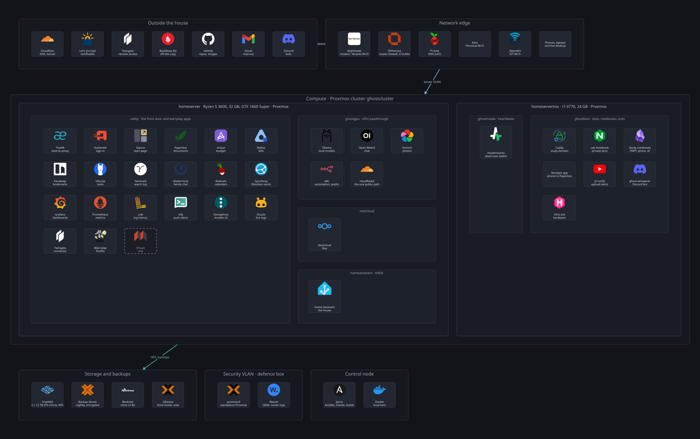
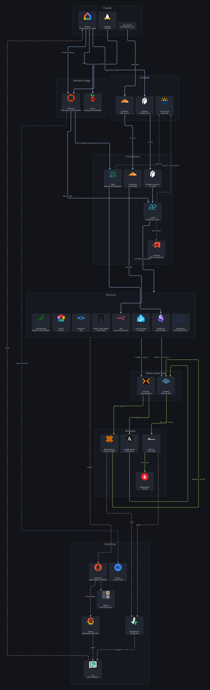

<div align="center">

<sub><code>LAB NOTEBOOK · SINCE DEC 2022</code></sub>

# myhomelab

**Two Proxmox nodes, one NAS, plain Docker Compose.**<br>
The compose files, playbooks and templates behind a household's photos, documents, money and notes.

   

        <br>
 

<a href="diagrams/overview.svg"></a>

<sub>The whole lab on one page. Click for full size · <a href="#02--how-it-fits-together">how things move</a></sub>

</div>

---

### `01` · What this is

A homelab that replaced most of the SaaS a household pays for, rebuilt in November 2026 from k3s to Docker Compose on VMs. Everything here is the real configuration with the secrets taken out: every stack reads its passwords, paths and addresses from a `.env` file that never leaves the machine.

| Replaces | With | Stack |
|---|---|---|
| Google Photos | Immich | [`docker/immich`](docker/immich) |
| Google Drive | Nextcloud | [`docker/nextcloud`](docker/nextcloud) |
| YNAB | Actual Budget + bank sync | [`docker/actual-budget`](docker/actual-budget) |
| Filing cabinet | Paperless-ngx (OCR, tags) | [`docker/paperless`](docker/paperless) |
| Pocket | Karakeep | [`docker/karakeep`](docker/karakeep) |
| Todoist | Vikunja | [`docker/vikunja`](docker/vikunja) |
| Google Calendar | Radicale (CalDAV) | [`docker/radicale`](docker/radicale) |
| ChatGPT | Ollama + Open WebUI on a GTX 1660 | [`docker/Ollama`](docker/Ollama) |
| Zapier | n8n | [`docker/n8n`](docker/n8n) |
| Slack | Mattermost | [`docker/mattermost`](docker/mattermost) |
| Datadog | Prometheus · Grafana · Loki · Dozzle | [`docker/monitoring`](docker/monitoring) |

---

### `02` · How it fits together

How a request, a file, a backup and an alert move through the lab, outside in.

<a href="diagrams/flow.svg"></a>

<div align="center">


</div>

Both maps are text: [`diagrams/*.d2`](diagrams), drawn with [D2](https://d2lang.com) and the ELK layout, icons from [dashboard-icons](https://github.com/homarr-labs/dashboard-icons). Run `diagrams/render.sh` (Docker, nothing to install) to redraw them.

| Layer | Choice | Why |
|---|---|---|
| Hypervisor | Proxmox VE, 2-node cluster | Ryzen 5 3600 + GTX 1660 Super, and an HP i7-3770 |
| Storage | TrueNAS, ZFS mirror 2 × 12 TB | Databases never on NFS; files always on it |
| Workloads | Docker Compose, one folder per stack | k3s retired 2 Nov 2026: less to know, less to break |
| Front door | Traefik v3, file provider | One routes file, one wildcard certificate |
| Second front door | Caddy, for a separate study domain | Study notebooks kept apart from the lab: own domain, own certificate, own token |
| Identity | Authentik | OIDC for Grafana and Proxmox, more to come |
| VMs | Ansible-built template + clone playbook | A new VM is one command and arrives hardened |
| Backups | Proxmox Backup Server 22:00 · Ansible dumps 05:30 · restic to B2 06:00 | Whole guests and databases, then an encrypted copy off-site |
| Security | Wazuh on an isolated VLAN | Kept apart from what it watches |

---

### `03` · Repository map

| Path | Holds |
|---|---|
| [`docker/<stack>/`](docker) | `docker-compose.yaml` + `.env.example` for each stack |
| [`docker/traefik/dynamic/`](docker/traefik/dynamic) | Every route and middleware |
| [`ansible/`](ansible) | Baseline, backups, the VM template and clone playbooks ([README](ansible/README.md)) |
| [`diagrams/`](diagrams) | The two maps above, as D2 source and rendered SVG |
| [`docs/GUIDE.md`](docs/GUIDE.md) | **How to use this yourself**: everything, one service, or a stack |
| [`terraform/`](terraform) | Proxmox provider and VM module (optional; Ansible creates VMs today) |
| [`myK8S/`](myK8S) | The retired k3s manifests, kept for reference |
| [`archive/`](archive) | Retired stacks |

---

### `04` · Run it yourself

Three ways in, all in **[the guide](docs/GUIDE.md)**:

| You want | Start at |
|---|---|
| One app (say, Paperless) on any Docker host | [Guide → one service](docs/GUIDE.md#one-service) |
| A group that belongs together (say, the monitoring stack) | [Guide → a stack](docs/GUIDE.md#a-stack) |
| The whole lab on Proxmox, the way it runs here | [Guide → everything](docs/GUIDE.md#everything) |

```bash
git clone https://github.com/ghimireaacs/myhomelab && cd myhomelab/docker/paperless
cp .env.example .env && $EDITOR .env      # your paths, domain, passwords
docker compose up -d
```

---

### `05` · Rules this repo keeps

| Rule | Because |
|---|---|
| Secrets only in `.env`; `.env.example` holds placeholders | Public repo |
| Postgres and SQLite on local disk, never NFS | A Postgres on NFS crash-looped 7,054 times |
| Images pinned to a version, majors by hand | Silent `:latest` updates broke things |
| Every stack pins its compose `name:` | Any checkout of the repo manages the same containers |
| Port 8080 is cAdvisor's on every VM | It ships in the template |
| New state on a VM's disk goes in `ansible/host_vars` | Otherwise the nightly backup doesn't know it exists |

> **Field note.** *Symptom:* the nightly backup said `ok` for months and wrote nothing. *Cause:* a folded YAML line broke the dump command and `failed_when: false` hid it. *Fix:* failures now show, and the files get checked, not the recap.

---

<div align="center"><sub>Built and broken by <a href="https://github.com/ghimireaacs">@ghimireaacs</a> · notes at <a href="https://ashishghimire.com">ashishghimire.com</a></sub></div>
